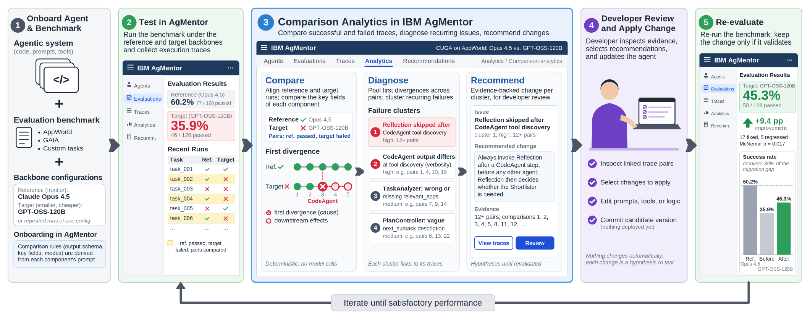
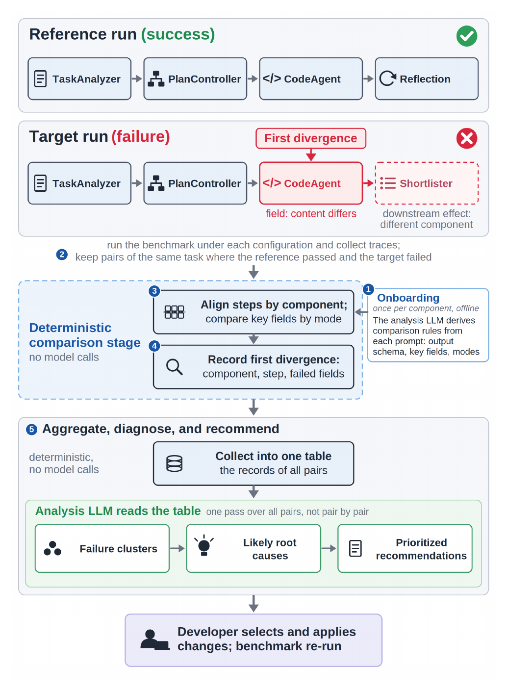

<h1 align="center">Trace Comparison for Actionable Diagnostics<br>and Improvement of Agentic Systems</h1>

<p align="center">
  Sergey Zeltyn · Iftach Shoham · Dany Moshkovich · Ido Levy · Inna Skarbovsky · Roy Abitbol · Segev Shlomov
  <br>
  <em>IBM Software Innovation Lab, Israel</em>
</p>

<p align="center">
  
  <a href="LICENSE"></a>
  <a href="https://github.com/roy651/trace_compare/actions/workflows/ci.yml"></a>
  
  
</p>

<p align="center">
  
</p>

Your agent passes a task on one run and fails it on the next, or passes with a frontier model and
fails with a cheaper one. **Which component broke, and what should change?**

`trace-compare` is the reference implementation of the paper's *comparison analytics*. It takes a
successful run as a demonstration, finds where a failed run of the same task **first diverges** from
it, and pools those divergences across many runs into failure clusters with proposed fixes.

- **Deterministic where it counts.** Aligning and comparing traces makes no model calls, so it is
  cheap, fast and reproducible. An LLM is used only once at onboarding and once to read the pooled result.
- **Works on telemetry you already have.** No re-execution, no replay environment.
- **Localizes to a component and a field**, not just "the run failed".

## Quickstart

No API key, no GPU, under a minute:

```bash
git clone https://github.com/roy651/trace_compare.git && cd trace_compare
python -m venv .venv && source .venv/bin/activate
pip install -e .
trace-compare demo
```

The demo compares passed and failed runs of a small synthetic travel-booking agent
([`examples/toy_agent`](examples/toy_agent)) and ends with one line per pair:

```text
#  task                   first divergence                                    end state
1  flight-bos-den         step 2 ToolSelector (selected_tools)                Both traces completed
2  flight-lon-tyo         step 2 ToolSelector (selected_tools)                Final divergence: Failed trace completed
3  flight-sea-sfo         none                                                Final divergence: different agents are called for the two traces
4  hotel-austin-calendar  step 1 Planner (required_apps, steps, steps[].app)  Both traces completed
5  hotel-paris            step 2 ToolSelector (selected_tools)                Both traces completed
6  trip-chicago           step 1 Planner (required_apps, steps[].app)         Both traces completed
```

Three of six failures start at the same place: the `ToolSelector` leaves out a tool. That recurring
pattern is what the method is after. The full step-by-step report shows the evidence:

```text
### Step 2
Successful trace: ToolSelector
Failed trace: ToolSelector

Comparison field: selected_tools
Successful trace: ['flights.search', 'flights.book', 'payments.charge']
Failed trace: ['flights.search', 'payments.charge']
Comparison mode: exact_match
**Fields are different**

**First divergence between steps is detected**
Agent name: ToolSelector
Different fields: selected_tools
```

The same step-1 comparison finds the two `Planner` outputs worded differently
(`"Book the cheapest Boston to Denver flight…"` vs `"Book cheapest flight Boston to Denver…"`) and
correctly treats them as the same, because that field is compared by fuzzy match. The complete
expected output is in [`examples/toy_agent/expected`](examples/toy_agent/expected).

## How it works



**Input 1: comparison rules, once per agent.** An LLM reads each component's prompt and writes its
output schema, the *key fields* whose difference means a behavioral difference, and a
*comparison mode* for each field.

**Input 2: trace pairs.** For each task, pair a run that passed with a run that failed. The two can
come from different backbones (*backbone migration*) or from repeated runs of one configuration
(*self-comparison*).

**Stage 1: align and compare.** Walk the two runs step by step. Where both invoke the same
component, compare its key fields by their modes. A step is similar only if every key field passes.

**Stage 2: first divergence.** Record the earliest differing step: component, step, failed fields.
Keep going to see how the difference propagates.

**Stage 3: aggregate and diagnose.** One LLM pass over all pairs returns failure clusters, likely
root causes and prioritized recommendations, each linked to the pairs that show it.

Comparison modes:

| Mode | Two values count as the same when |
|---|---|
| `exact_match` | they are equal (deep; strings ignore surrounding whitespace, lists ignore order) |
| `fuzzy_match` | string similarity is at least 85 |
| `semantic_similarity` | embedding cosine is at least 0.75 |
| `approximate_numeric` | numbers differ by at most 0.05 |
| `list_length` | they have the same type and length |
| `field_exists` | the field is present in both or absent in both |

<br clear="right">

## Use it on your own agent

**1. Describe the agent.** Create a directory with a `manifest.json` that maps each component to
its system prompt, and a short `system_description.md`. Copy
[`examples/toy_agent`](examples/toy_agent) as a starting point.

**2. Generate comparison rules** (one LLM call per component). Any provider supported by
[LiteLLM](https://docs.litellm.ai/docs/providers) works: Anthropic, OpenAI, Azure, Bedrock,
watsonx, Gemini, or an OpenAI-compatible endpoint of your own.

```bash
cp .env.example .env      # set LLM_MODEL and your provider's key
trace-compare design-rules --agent my_agent/
```

This writes `my_agent/rules.txt`. Read it and edit it; it is plain JSON.

**3. Collect traces** as [Langfuse](https://langfuse.com/) trace exports, one file per run:

```text
traces/<task_id>/pass/*.json
traces/<task_id>/fail/*.json
```

**4. Compare** (no model calls):

```bash
trace-compare compare --traces traces/ --agent my_agent/ --out out/
```

This writes `out/step_comparison.md` (the report) and `out/divergences.json` (one first-divergence
record per pair). `--pairing-mode` selects one pair per task (default), `n_pairs`,
`all_trajectories` or `all_permutations`.

**5. Diagnose** (one LLM call over the whole report):

```bash
trace-compare diagnose --report out/step_comparison.md --agent my_agent/
```

This writes `out/summary.md` with clusters, root causes and recommendations. On CUGA and AppWorld, an
entry of that report looks like this (Figure 7 of the paper):

```text
## Premature Shortlister invocation after CodeAgent tool discovery
**Severity:** high

In the majority of failed traces, after the CodeAgent performs tool discovery (calling
`find_tools`), the next step routes to the Shortlister agent instead of the Reflection agent.
In successful traces, the CodeAgent's tool discovery output is first evaluated by the Reflection
agent before proceeding. This pattern appears in 12+ comparisons ...
```

`--model` overrides `LLM_MODEL` for a single run. Semantic similarity needs an embedding model:
`pip install -e ".[semantic]"`.

## Paper to code

| In the paper | In this repository |
|---|---|
| Comparison rules synthesized at onboarding (Input 1) | [`design_rules.py`](src/trace_compare/design_rules.py), [`prompts/comparison_designer.jinja`](src/trace_compare/prompts/comparison_designer.jinja) |
| Key fields and comparison modes (Appendix C) | [`modes.py`](src/trace_compare/modes.py), [`rules.py`](src/trace_compare/rules.py) |
| Normalizers for outputs that are not valid JSON | [`normalizers.py`](src/trace_compare/normalizers.py) |
| Pair selection (Input 2) | [`pairing.py`](src/trace_compare/pairing.py) |
| Alignment and step comparison (Stage 1) | [`align.py`](src/trace_compare/align.py) |
| First divergence (Stage 2) | [`align.py`](src/trace_compare/align.py), `divergences.json` |
| Aggregation and recommendations (Stage 3) | [`diagnose.py`](src/trace_compare/diagnose.py), [`prompts/root_cause_analysis.jinja`](src/trace_compare/prompts/root_cause_analysis.jinja) |
| Trace representation | [`ir.py`](src/trace_compare/ir.py), [`adapters/langfuse.py`](src/trace_compare/adapters/langfuse.py) |
| CUGA prompts and rules used in the AppWorld experiments | [`examples/cuga_appworld`](examples/cuga_appworld) |

## Results from the paper

**Backbone migration on AppWorld.** Success rate (%) before and after one round of trace-guided
changes. CUGA: reference Claude Opus 4.5, target GPT-OSS-120B. ReAct: reference GPT-5.4, target
GPT-OSS-120B.

| Agent | Split | Tasks | Reference | Before | After | Gain (pp) |
|---|---|---:|---:|---:|---:|---:|
| CUGA | Easy | 43 | 93.0 | 62.8 | 72.1 | +9.3 |
| CUGA | Medium | 40 | 47.5 | 27.5 | 45.0 | +17.5 |
| CUGA | Hard | 45 | 40.0 | 17.8 | 20.0 | +2.2 |
| CUGA | **Overall** | 128 | 60.2 | 35.9 | **45.3** | **+9.4** |
| ReAct | Easy | 43 | 93.5 | 65.1 | 72.1 | +7.0 |
| ReAct | Test-Normal | 168 | 92.9 | 45.0 | 55.4 | +10.4 |
| ReAct | Test-Challenge | 417 | 89.9 | 26.0 | 34.0 | +8.0 |

For CUGA this recovers 39% of the performance lost in the backbone swap (McNemar exact test,
p = 0.017). The ReAct changes were derived from the Easy tasks only and carry over to the larger sets.

**Self-comparison on GAIA** (Claude Sonnet 4.6, 10 runs per task).

| Agent | Level | Accuracy before | Accuracy after | Consistency before | Consistency after |
|---|---|---:|---:|---:|---:|
| ReAct | L3 | 34.0 | 39.2 | 47.0 | **81.2** |
| MiroFlow | L1 | 65.0 | 66.0 | 58.0 | 60.8 |

These experiments ran the benchmarks with the [cuga-eval](https://github.com/cuga-project/cuga-eval)
harness, which also contains this analytics in its original form. The approach helps most when the
smaller backbone can do the task but does so unreliably; it does not make up for a capability the
model lacks, and each recommendation is a hypothesis to re-evaluate.

## Development

```bash
pip install -e ".[dev]"
pytest
ruff check
```

The test suite includes golden reports produced by the original implementation in cuga-eval; this
package reproduces them byte for byte. Three small defects of the original are fixed here: `exact_match`
no longer treats `True` and `1` as equal, an empty output of the failed run is now reported, and
`design-rules` accepts a fenced reply that ends in a newline.

## Notes on the implementation

This is the code that produced the paper's results, and it is simpler than the general description
in a few places: steps are aligned in order with a retry-skipping heuristic, pairs are sampled at
random within the selected budget, the analysis LLM reads the Markdown comparison report, and traces
are read from Langfuse exports.

## Citation

```bibtex
@inproceedings{zeltyn2027tracecomparison,
  title     = {Trace Comparison for Actionable Diagnostics and Improvement of Agentic Systems},
  author    = {Zeltyn, Sergey and Shoham, Iftach and Moshkovich, Dany and Levy, Ido and
               Skarbovsky, Inna and Abitbol, Roy and Shlomov, Segev},
  booktitle = {Proceedings of the AAAI Conference on Artificial Intelligence (IAAI)},
  year      = {2027},
  note      = {To appear}
}
```

## Acknowledgements

The code in this repository is extracted from
[cuga-eval](https://github.com/cuga-project/cuga-eval), the evaluation harness of the CUGA project,
and the CUGA example uses component prompts from
[cuga-agent](https://github.com/cuga-project/cuga-agent). Both are Apache-2.0; see [NOTICE](NOTICE).

## License

[Apache License 2.0](LICENSE)
